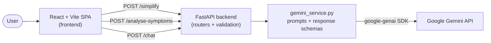

<div align="center">


# Sahayak

### Your AI health companion

Understand medical reports, check symptoms, and get clear answers in plain language.<br/>
*Sahayak (सहायक) means "helper".*

<br/>


[Features](#features) &nbsp;·&nbsp;
[Architecture](#architecture) &nbsp;·&nbsp;
[Quick start](#quick-start) &nbsp;·&nbsp;
[API reference](#api-reference) &nbsp;·&nbsp;
[Configuration](#configuration) &nbsp;·&nbsp;
[Troubleshooting](#troubleshooting)

</div>

---

> [!WARNING]
> **Sahayak is an informational aid, not a medical device.** It does not diagnose, treat, or replace a licensed doctor. Its AI prompts are written to avoid definitive diagnoses and to avoid naming prescription drugs or dosages, but AI output can still be wrong. For anything urgent or worrying, contact a healthcare professional or local emergency services.

## About

Medical reports are full of jargon, and searching symptoms online often raises more worries than answers. **Sahayak** is a full-stack web app that uses Google's Gemini models to turn that complexity into short, friendly explanations anyone can follow.

It ships with three AI-powered tools behind a clean, responsive React interface and a lightweight FastAPI backend.

## Features

| Tool | What you do | What you get |
| :-- | :-- | :-- |
| **Report Simplifier** | Upload a lab report, prescription, or scan report as a **PDF, JPG, or PNG** (up to 15 MB by default). | A friendly title, a plain-language summary, key findings with out-of-range values called out, and general next-step advice. |
| **Symptom Analyser** | Add up to **20 symptoms** as tags (press <kbd>Enter</kbd> to add one). | The most likely common condition, a **confidence score** (0-100), and 3-4 other possibilities to consider. Urgent-sounding symptoms prompt a stronger "seek care now" disclaimer. |
| **Sahayak AI chat** | Open the floating chat bubble on any page and ask a health or wellness question, by typing or by **voice**. | A short, warm, conversational reply rendered in Markdown. Urgent topics are met with advice to seek immediate help. |

**Also included**

- **Light and dark themes**, remembered between visits.
- **Responsive layout** with a mobile navigation menu.
- **Structured AI output.** Gemini is constrained to a JSON schema defined with Pydantic, so the UI always receives predictable fields.
- **Built-in safety guardrails** in every prompt (no definitive diagnoses, no specific drugs or dosages, emergency escalation).
- **Interactive API docs** (Swagger UI and ReDoc) generated by FastAPI.

> [!NOTE]
> On the Symptom Analyser page, the "Recommended Next Steps" and "When to Seek Immediate Help" panels are **static guidance** written into the interface. They are not generated by the AI. Only the result card and the "Other Conditions" list come from Gemini.

## Architecture



**How a request flows**

1. The React app calls the backend at the URL set in `VITE_API_URL`.
2. A FastAPI router validates the input (file type and size, non-empty symptoms, non-empty message).
3. `gemini_service.py` sends the input to Gemini with a task-specific system prompt. Report files are passed to the model directly as PDF or image bytes, so there is no separate OCR step.
4. For reports and symptoms, Gemini is asked for JSON that matches a Pydantic schema. The response is validated before being returned to the UI.

**Design notes**

- All prompts and Gemini calls live in a single file, `backend/app/services/gemini_service.py`, which makes them easy to review and tune.
- Gemini failures are surfaced as `502` errors, and unexpected exceptions are caught by a global handler so stack traces never reach the client.
- The chat endpoint is **stateless**: each message is sent to Gemini on its own, without earlier conversation history.

## Tech stack

| Layer | Technologies |
| :-- | :-- |
| **Frontend** | React 19, Vite 8, React Router 7, react-markdown, lucide-react, Oxlint, Vercel Analytics |
| **Backend** | FastAPI, Uvicorn, Pydantic v2 and pydantic-settings, python-multipart |
| **AI** | Google Gemini API via the official [`google-genai`](https://pypi.org/project/google-genai/) SDK (default model alias: `gemini-flash-latest`) |

## Project structure

```text
Sahayak/
├── backend/
│   ├── app/
│   │   ├── main.py                  # FastAPI app: CORS, routers, health checks, error handler
│   │   ├── core/config.py           # Settings loaded from environment / .env
│   │   ├── models/schemas.py        # Pydantic request and response models
│   │   ├── routers/
│   │   │   ├── report.py            # POST /simplify
│   │   │   ├── symptoms.py          # POST /analyse-symptoms
│   │   │   └── chat.py              # POST /chat
│   │   ├── services/gemini_service.py   # Gemini calls + system prompts
│   │   └── utils/validators.py      # Upload type and size validation
│   ├── requirements.txt
│   └── run.py                       # `python run.py` dev entrypoint
│
└── frontend/
    ├── public/                      # Logo, hero image, illustrations
    ├── src/
    │   ├── main.jsx                 # Bootstrap: Router + ThemeProvider
    │   ├── App.jsx                  # Routes, theme toggle, chat widget, analytics
    │   ├── ThemeContext.jsx         # Light / dark theme state
    │   ├── pages/                   # Home, ReportSimplifier, SymptomAnalyzer
    │   └── components/              # Navbar, UploadBox, ResultCard, SahayakAI chat, ...
    ├── index.html
    ├── vite.config.js
    └── package.json
```

App routes: `/` (home), `/report-simplifier`, `/symptom-analyser`. The chat bubble is available on every page.

## Quick start

### Prerequisites

- **Python 3.11+**
- **Node.js 20.19+** (or 22.12+), required by Vite 8
- A **Gemini API key**, free from [Google AI Studio](https://aistudio.google.com/apikey)

### 1. Clone the repository

```bash
git clone https://github.com/<your-username>/Sahayak.git
cd Sahayak
```

### 2. Start the backend

```bash
cd backend

# Create and activate a virtual environment
python -m venv venv
source venv/bin/activate          # macOS / Linux
# venv\Scripts\Activate.ps1       # Windows (PowerShell)

# Install dependencies
pip install -r requirements.txt
```

Create a file named `.env` inside `backend/` and add your key:

```env
GEMINI_API_KEY=your_gemini_api_key_here
```

Run the server:

```bash
python run.py
# or: uvicorn app.main:app --reload
```

The API is now live at **http://localhost:8000**. Swagger UI is at [`/docs`](http://localhost:8000/docs) and ReDoc at [`/redoc`](http://localhost:8000/redoc).

> [!TIP]
> Open [`/health`](http://localhost:8000/health) to confirm the server is running and that `gemini_configured` is `true`.

### 3. Start the frontend

In a **second terminal**:

```bash
cd frontend
npm install
```

Create a file named `.env.local` inside `frontend/` that tells the app where the backend lives:

```env
VITE_API_URL=http://localhost:8000
```

> [!IMPORTANT]
> `VITE_API_URL` is **required**. Every API call in the frontend is built from it, so if it is missing the requests go to `undefined/...` and nothing works. Use no trailing slash. Vite reads this value at startup, so restart `npm run dev` after changing it.

Then start the dev server:

```bash
npm run dev
```

Open **http://localhost:5173** and you are ready to go.

### Frontend scripts

| Command | Description |
| :-- | :-- |
| `npm run dev` | Start the Vite dev server with hot reload |
| `npm run build` | Create an optimised production build in `dist/` |
| `npm run preview` | Preview the production build locally |
| `npm run lint` | Lint the source with Oxlint |

## Configuration

### Backend (`backend/.env`)

| Variable | Default | Description |
| :-- | :-- | :-- |
| `GEMINI_API_KEY` | *(required)* | Your Gemini API key. |
| `GEMINI_MODEL` | `gemini-flash-latest` | Model used for all three features. Pin a specific model name for reproducible behaviour. |
| `ALLOWED_ORIGINS` | `http://localhost:5173,http://127.0.0.1:5173,http://localhost:3000,http://127.0.0.1:3000` | Comma-separated list of origins allowed by CORS. Add your deployed frontend URL here. |
| `MAX_UPLOAD_MB` | `15` | Maximum report file size accepted by `/simplify`. |
| `APP_NAME` | `Sahayak Backend API` | Title shown in the API docs. |

### Frontend (`frontend/.env.local`)

| Variable | Example | Description |
| :-- | :-- | :-- |
| `VITE_API_URL` | `http://localhost:8000` | Base URL of the backend API, with no trailing slash. Embedded into the app at build time. |

## API reference

Base URL: `http://localhost:8000`. Full interactive documentation is available at `/docs`.

### `POST /simplify`

Simplify an uploaded medical report. Send `multipart/form-data` with a single `file` field (PDF, JPG, JPEG, or PNG).

```bash
curl -X POST http://localhost:8000/simplify \
  -F "file=@blood-report.pdf;type=application/pdf"
```

```json
{
  "title": "Complete Blood Count Report",
  "summary": "Your blood test looks mostly normal...",
  "findings": [
    "Hemoglobin is slightly below the normal range.",
    "White blood cell count is within normal limits."
  ],
  "advice": "Consider iron-rich foods and follow up with your doctor if you feel unusually tired."
}
```

If the uploaded file does not look like a medical report, the model is instructed to say so in `summary`, return no `findings`, and suggest re-uploading the correct document.

### `POST /analyse-symptoms`

Analyse a list of self-reported symptoms.

```bash
curl -X POST http://localhost:8000/analyse-symptoms \
  -H "Content-Type: application/json" \
  -d '{"symptoms": ["Fever", "Headache", "Body ache"]}'
```

```json
{
  "condition": "Viral Fever",
  "confidence": 65,
  "icon": "🤒",
  "status": "Analysis Complete",
  "disclaimer": "This is a possibility, for confirmation consult a doctor.",
  "otherConditions": [
    { "name": "Common Cold", "description": "Similar symptoms, usually milder." },
    { "name": "Dengue", "description": "Consider if you're in a high-risk area with body ache and high fever." }
  ]
}
```

`confidence` is an integer from 0 to 100. The `disclaimer` is adapted by the model when the symptoms sound urgent.

### `POST /chat`

Send one message to the Sahayak AI assistant.

```bash
curl -X POST http://localhost:8000/chat \
  -H "Content-Type: application/json" \
  -d '{"message": "What should I do for a mild headache?"}'
```

```json
{ "reply": "For a mild headache, rest in a quiet, dim room, stay hydrated..." }
```

### Health checks

| Endpoint | Returns |
| :-- | :-- |
| `GET /` | Service status and a pointer to `/docs`. |
| `GET /health` | `status`, whether `GEMINI_API_KEY` is configured (`gemini_configured`), and the active `gemini_model`. |

### Error responses

All errors return JSON with a `detail` field.

| Status | When it happens |
| :-- | :-- |
| `400` | Unsupported file type, empty file, file larger than `MAX_UPLOAD_MB`, or a blank symptom list or message after trimming. |
| `422` | Request body fails schema validation (for example, a missing field or an empty `symptoms` array). |
| `500` | `GEMINI_API_KEY` is not configured, or an unexpected server error occurred. |
| `502` | The Gemini call failed, or the model returned a response that could not be parsed. |

## Privacy and data handling

- **No database and no file storage.** The backend reads uploads into memory, forwards them to Gemini, and returns the result. Nothing is written to disk or persisted by the app.
- **Your data is processed by Google.** Reports, symptoms, and chat messages are sent to the Gemini API, so Google's API terms and data-handling policies apply. Do not submit information you are not comfortable sharing, and review those terms before using real patient data in any production setting.
- **Server logs.** When a Gemini call fails or returns unparseable output, the backend logs the error and a short fragment of the model's response for debugging. Treat logs accordingly.
- **Browser storage.** The only thing the frontend stores locally is your light/dark theme preference.
- **Analytics.** The frontend includes [Vercel Analytics](https://vercel.com/docs/analytics). Remove `<Analytics />` from `frontend/src/App.jsx` if you do not want it.

## Deployment notes

- **Frontend.** Run `npm run build` and host the `dist/` folder on any static host (the project is Vercel-ready). Set `VITE_API_URL` to your public backend URL **before building**. Because the app uses client-side routing, configure your host to serve `index.html` for all paths so that direct links such as `/report-simplifier` work.
- **Backend.** Run `uvicorn app.main:app --host 0.0.0.0 --port 8000` behind HTTPS. Avoid `run.py` in production, as it enables auto-reload.
- **CORS.** Add your deployed frontend origin to `ALLOWED_ORIGINS` on the backend.
- **Secrets.** Keep `GEMINI_API_KEY` in your host's environment settings. `backend/.env` is already git-ignored.

## Troubleshooting

| Symptom | Likely cause and fix |
| :-- | :-- |
| Frontend requests fail or go to `undefined/...` | `VITE_API_URL` is not set. Create `frontend/.env.local` and **restart** `npm run dev`. |
| Browser console shows a CORS error | Your frontend origin is not allowed. Add it to `ALLOWED_ORIGINS` in `backend/.env` and restart the backend. |
| `500` - "GEMINI_API_KEY is not configured" | Create `backend/.env` with your key and restart. `/health` should then report `gemini_configured: true`. |
| `502` - "Failed to analyse..." | The Gemini request failed. Check that the key is valid, your quota is available, and `GEMINI_MODEL` is a valid model name. The backend log shows the underlying error. |
| `400` - "Unsupported file type" | Only PDF, JPG, JPEG, and PNG files are accepted. |
| `pip install` fails with a Python version error | Use Python 3.11 or newer. |
| `npm run dev` fails on startup | Upgrade Node.js to 20.19+ (or 22.12+). |
| Microphone button does nothing | Voice input uses the browser's Web Speech API (English, `en-US`), which is not available in every browser. Use a supported browser and allow microphone access. |

## Roadmap ideas

- [ ] Women's Health module (a navigation entry is already stubbed in the code)
- [ ] Multi-turn chat with conversation history
- [ ] Clearer in-app error messages when the backend returns an error
- [ ] Automated tests for the API and UI

## Contributing

Contributions, bug reports, and ideas are welcome.

1. Fork the repository and create a branch: `git checkout -b feature/your-feature`
2. Make your changes and run `npm run lint` in `frontend/`
3. Commit with a clear message and push your branch
4. Open a pull request describing what you changed and why

## Acknowledgements

Built with [Google Gemini](https://ai.google.dev/), [FastAPI](https://fastapi.tiangolo.com/), [React](https://react.dev/), [Vite](https://vite.dev/), [Pydantic](https://docs.pydantic.dev/), [react-markdown](https://github.com/remarkjs/react-markdown), and [Lucide](https://lucide.dev/) icons.

<div align="center">

<sub>Made to make healthcare information easier to understand. Not a substitute for professional medical advice.</sub>

</div>
